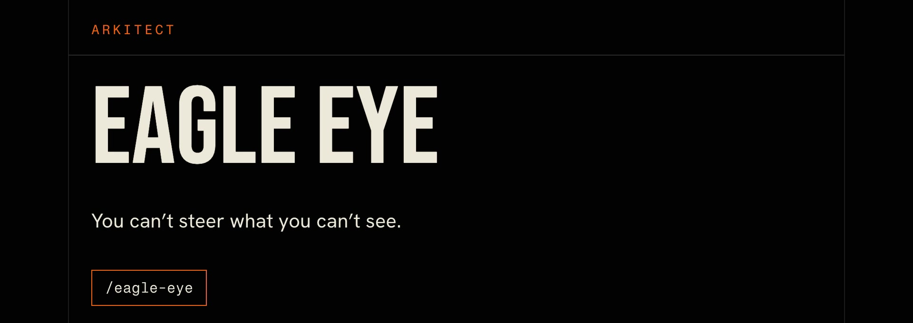
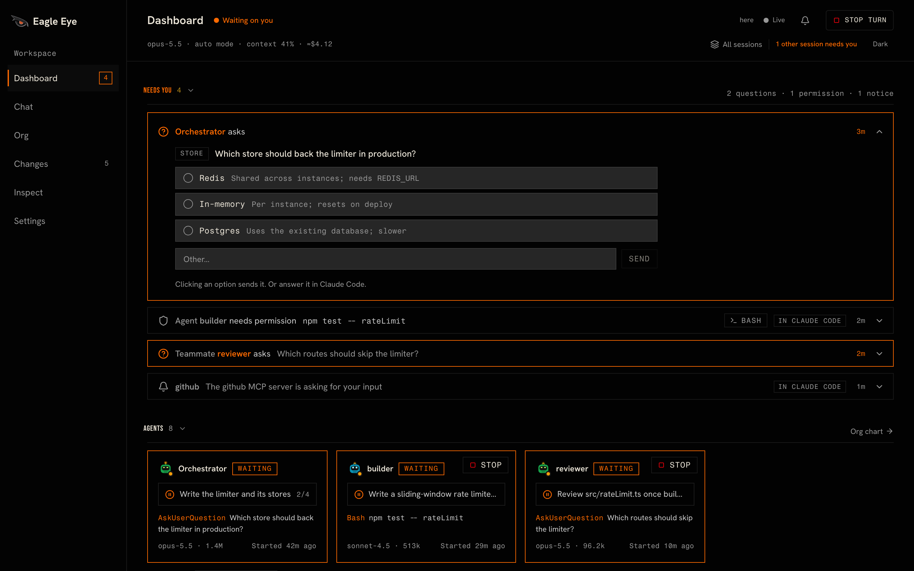
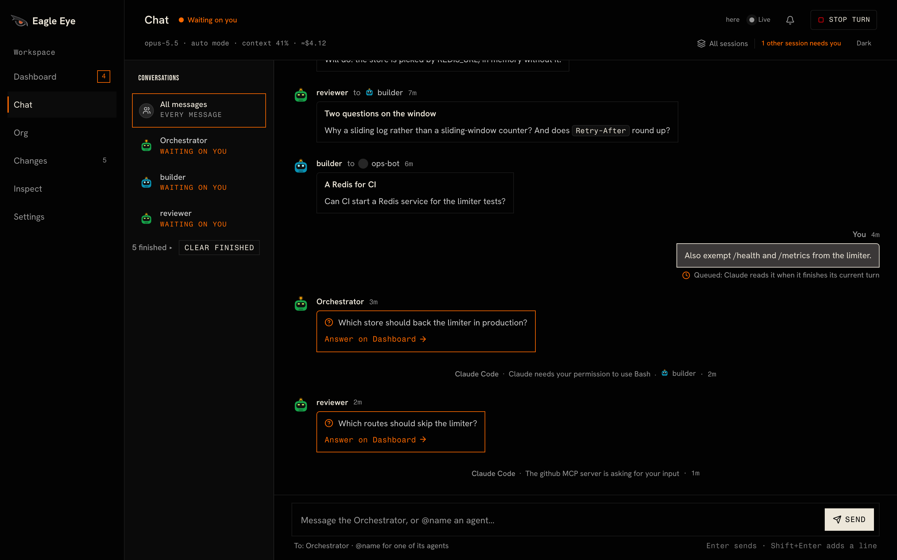
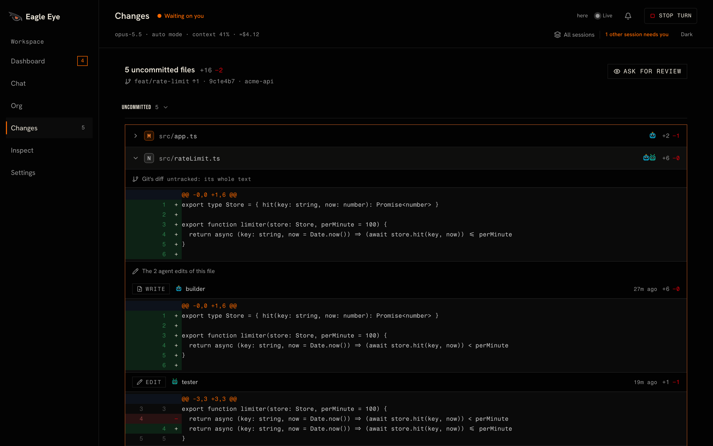
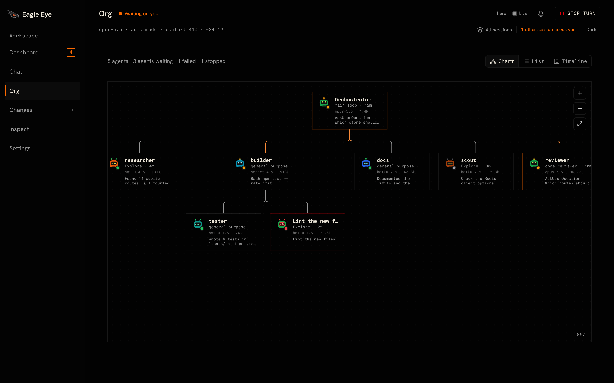
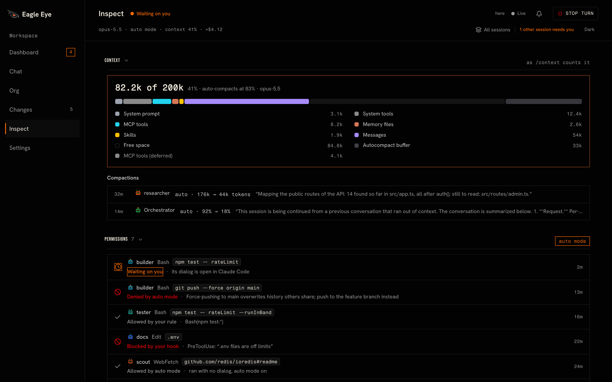

[Install](#install) · [What you see](#what-you-see) · [Examples](#examples) · [Commands](#commands) · [How it works](#how-it-works) · [Privacy](#privacy)

[](https://github.com/arkitectco/eagle-eye/actions/workflows/test.yml) [](LICENSE)

Running a team of agents in Claude Code is a bit like a group project over text. Somebody is still working, somebody finished, somebody is waiting on you, and the thread will not say which is which. Eagle Eye is a mod that puts a live deck where you already work: the Claude Desktop side pane, the terminal, or a browser tab. It shows every agent and subagent, what each one is doing right now, who started it, what they tell each other, and which files each one changed. Install it, run `/eagle-eye`, and keep working. Your setup stays as it is.

Eagle Eye only shows what Claude Code is already doing. It reads the events Claude Code reports and what git says about your files, and it passes every permission check, tool call, and prompt through unchanged. It acts only when you press something on the deck, and then through Claude Code's own channels. (It watches. It doesn't take the wheel.)

<a id="install"></a>

## Where do you start?

### In the Claude Desktop app

The Desktop app runs Claude Code, and it doesn't add the `claude` command to your terminal. `/plugin` doesn't run in its Code tab either. Ask Claude to install Eagle Eye. Paste this into a chat in the Code tab:

```
Add the Eagle Eye plugin to my Claude Code user settings. In ~/.claude/settings.json, add "extraKnownMarketplaces": {"eagle-eye": {"source": {"source": "github", "repo": "arkitectco/eagle-eye"}}} and "enabledPlugins": {"eagle-eye@eagle-eye": true}, and keep everything else in the file as it is.
```

Claude Code then downloads Eagle Eye from GitHub in the background. Give it a moment, start a new session, and type `/eagle-eye`. It doesn't appear in the slash-command menu yet. Type it in full and it runs. To turn Eagle Eye off or remove it later, click + next to the prompt box and choose Plugins, then Manage plugins.

### In the terminal

If the `claude` command works in your terminal, one command installs Eagle Eye:

```
claude plugin install eagle-eye --marketplace arkitectco/eagle-eye
```

Inside a Claude Code session, run these instead. The install shows what the plugin adds and asks where to install it. Install for you (user scope) and it is there in every project.

```
/plugin marketplace add arkitectco/eagle-eye
/plugin install eagle-eye@eagle-eye
```

Then run `/eagle-eye`.

The terminal and the Desktop app read the same settings, so installing Eagle Eye in one puts it in the other. An install copies only this repository's `plugin/` folder.

### What it needs

It needs Claude Code 2.1.304 or later, in the terminal or in the Code tab of the Claude Desktop app, and Node.js 22 or later on your PATH. Node.js isn't only for the web page. Eagle Eye also uses it to make its folders private and clear out what a session leaves behind, to write the debug dump, to check which listed sessions still run, and to show the text of new files in Changes. Changes needs git 2.26 or later.

<a id="what-you-see"></a>

## What do you actually see?

The Dashboard has a card for each agent with what it is doing right now, then the session's figures, the plan, recent activity, and the files the agents touched. When an agent asks you something, that question sits at the top. You shouldn't have to scroll for the one thing that needs a human.

- Chat shows the session as a group chat, including the messages agents send each other.
- Org shows who started whom, as a chart or as a timeline of each agent's run.
- Changes shows git's diff of each uncommitted file next to each agent's own edits of it.
- Each agent has a page with its task, to-do list, result, tool calls, and edits.
- Inspect shows what fills the context, every permission decision and who made it, what is loaded, and the spend per agent.
- Background lists the background shells, agents, and schedules still running.
- All sessions lists every Claude Code session on this machine that runs Eagle Eye, so one deck can check on all of them.

When you do need to step in, you can answer Claude's questions, message an agent, or stop an agent, a background task, or the turn, from the deck.

| Dashboard | Chat |
| :-: | :-: |
|  |  |
| Changes | Org chart |
|  |  |
| Inspect | |
|  | |

<a id="examples"></a>

## Want to see it move?

Ask for work that several agents share:

```
Use three subagents in parallel to review src/auth: security, missing tests and docs.
```

Run `/eagle-eye` while they work. The Dashboard has a card for each of them with its current step, and Chat shows what each one reports back.

To answer Claude from the deck, have it ask you something:

```
Before you change anything, ask me which database to use.
```

The question shows at the top of the Dashboard with its options. Press one to answer, in the pane or on the web page.

After agents have edited files in a git repository, `/eagle-eye changes` shows git's diff of each uncommitted file next to the edits each agent made to it, so you can see who changed what.

To look around before you run any agents, use `/eagle-eye demo`. The deck shows a sample session in which a team of agents adds rate limiting to an API, with several things waiting on you. Nothing you press there reaches Claude, and Back to this chat returns to your own session. Call it a fire drill. Nobody gets paged.

<a id="commands"></a>

## The commands

| Command | What it does |
| :- | :- |
| `/eagle-eye` | Opens the deck on the Dashboard |
| `/eagle-eye chat`, `org`, `changes`, `inspect`, `settings` | Opens that tab. A prefix works: `/eagle-eye i` is Inspect |
| `/eagle-eye sessions` | Opens All sessions |
| `/eagle-eye web` | Starts the web page and opens it in your own browser, as Open in browser at the top of the deck does |
| `/eagle-eye web stop` | Stops the web page. Its links stop working |
| `/eagle-eye demo` | Shows the deck on sample data |
| `/eagle-eye clear` | Hides finished agents from the deck (Claude Code is untouched) |
| `/eagle-eye clear show` | Shows them again |
| `/eagle-eye avatars [style]` | Lists the ten avatar styles, or picks one |
| `/eagle-eye band` | Hides or shows the status line above the prompt |
| `/eagle-eye close` | Closes the deck |

Keys work while the pane has the keyboard (click it, or press ctrl+x then tab): `1` to `6` switch tabs, `Enter` opens what has the focus, `b` goes back from an agent's page, `s` opens All sessions, and `o` opens the deck in your own browser, as Open in browser does. The web page adds a few of its own, listed under Help in its Settings.

<a id="how-it-works"></a>

## So how does it work?

Eagle Eye hooks Claude Code's events (tool calls, agent spawns, turns, messages, permission checks, and notifications) into one model of the session, which the pane, the terminal, and the web page all draw from. Everything it shows comes from what Claude Code and git report. Changes never credits a git hunk to an agent. The edits beside git's diff are the patches from each agent's own Edit and Write calls. Git's diff is git's. The agent's edits are the agent's. Mix those up and you blame the wrong cook.

When you step in, it acts only through Claude Code's own channels: answering the questions Claude asks you, delivering your messages, TaskStop for background agents and tasks, CronDelete for schedules, and the same abort as Esc for the turn. Stop and Cancel appear only where Claude Code's permission check allows that call, and the check runs again before each press. Eagle Eye never grants itself a permission and never answers a permission prompt. Nah, that's not what this is for. In auto mode, where Claude Code refuses a plugin's message to a subagent, the deck asks the Orchestrator to pass yours on, and that request shows in the chat.

Where Claude Code loads its built-in guard (on a Team or Enterprise login, or a machine with managed settings), a mod's hooks on `classic.*` events, `session.compact`, and `prompt.context` don't run. The agents, their tool calls and messages, Changes, Claude's questions, and Stop all still work there. Permission prompts and Claude Code's notifications don't show as waiting on you, though, and Inspect has no compactions, instruction files, or permission mode.

<a id="privacy"></a>

## Privacy

Prepare for the worst, hope for the best. Here is the short version.

- Eagle Eye makes no network requests of its own. What it hands to Claude goes through Claude Code like anything you type.
- It reads Claude Code's events for the session, the session's transcript, and what git says about your repositories. Its files live in `~/.claude/eagle-eye/`, in folders only you can open, and a session's files go when the session ends. The debug dump, which you turn on yourself, stays until you delete it.
- The web page runs only after you start it. It listens on 127.0.0.1, each link to it opens one page, and Eagle Eye never hands a link to Claude.

[PRIVACY.md](PRIVACY.md) has the rest: everything Eagle Eye runs, writes, and reads, and what stays as it is.

## When something breaks

Report bugs and ask for features in [GitHub issues](https://github.com/arkitectco/eagle-eye/issues). Report a security problem privately instead, as [SECURITY.md](SECURITY.md) describes.

A dump of what the deck believes helps with a bug. Create the folder `~/.claude/eagle-eye/debug/` and Eagle Eye writes `<session id>.json` there about 2 seconds after each change. Read it before you attach it. If it holds anything private, leave that out. Delete the folder to stop the dump.

## If you want to build on it

See [CONTRIBUTING.md](CONTRIBUTING.md). To try a clone without installing it, run `claude --plugin-dir plugin` in its folder. `/eagle-eye probe` toggles a test pane for mod authors.

```
claude plugin validate plugin
scripts/test.sh                 # the mod's tests, one file at a time
node --test tests/web/          # the server and page tests
node plugin/web/dev.js          # the web page on sample data; prints its link
```

## License

Apache 2.0. See [LICENSE](LICENSE) and [NOTICE](NOTICE). Copyright (c) 2026 Arkitect.

You can't steer what you can't see.
